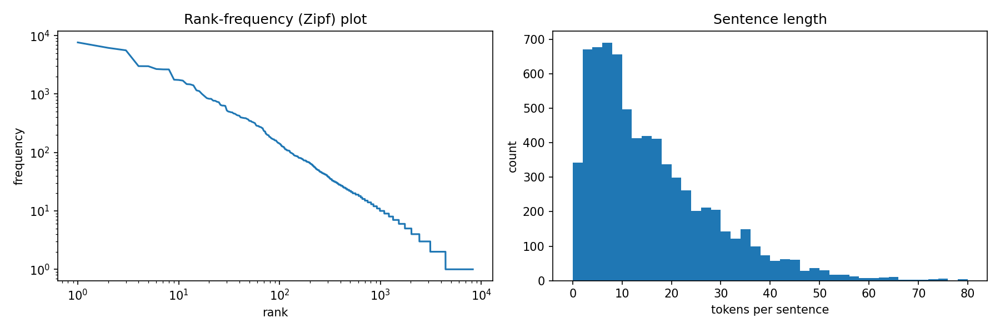
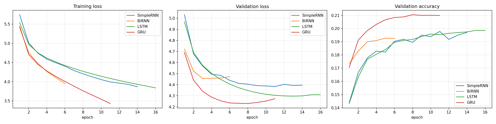
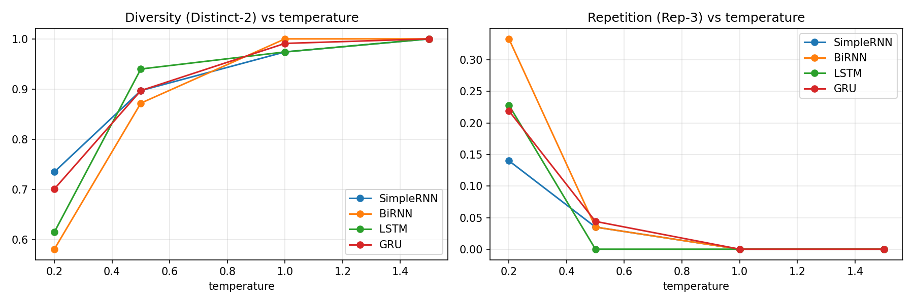

# Autoregressive Text Generation on *The Adventures of Sherlock Holmes*: SimpleRNN, BiRNN, LSTM and GRU

Foundations of Generative AI (ICT4403), Assignment 2  
Rudra Rajpurohit, 230911570

## Problem statement and objective

An autoregressive language model writes text one word at a time. At every step it reads the words it has so far, produces a probability distribution over the vocabulary for the next word, and the word drawn from that distribution is appended to the input for the following step. This project builds a word-level generator of this kind and asks which recurrent architecture does the job best on a single book.

Four models are compared: a simple RNN, a bidirectional RNN, an LSTM and a GRU. They share the data, the vocabulary, the input length, the embedding, the layer width, the optimiser, the batch size, the random seed and the stopping rule, so the recurrent layer is the only thing that changes from one model to the next. Each model is scored on held-out text by loss, perplexity, next-word accuracy and training time. Each is then asked to continue the same three seed passages at four sampling temperatures, and the generated text is compared for coherence, diversity, contextual consistency and repetition.

## Dataset

The corpus is *The Adventures of Sherlock Holmes* by Arthur Conan Doyle, Project Gutenberg eBook #1661.

- Source page: https://www.gutenberg.org/ebooks/1661
- Plain-text file used by the notebook: https://www.gutenberg.org/cache/epub/1661/pg1661.txt
- A copy of the downloaded file is kept in `data/sherlock_raw.txt`. The book is in the public domain in the United States.

The book collects twelve short stories narrated by Dr Watson, and much of it is dialogue. That mix suits the comparison. Dialogue has short, formulaic turns ("said holmes") that any of the models can pick up quickly, while the narration has long sentences that test whether a model can keep a clause together.

| Property | Value |
|---|---|
| Raw file | 581,601 characters |
| Tokens after cleaning | 119,654 (104,468 words and 15,186 punctuation marks) |
| Distinct tokens | 8,236 |
| Tokens seen only once | 3,826 |
| Sentences | 7,267 |
| Sentence length | mean 15.5, median 12, 95th percentile 40 tokens |

Word frequencies follow the usual Zipf pattern, a near-straight line on log-log axes in the left plot below. The consequence is a long tail: 3,826 of the 8,236 distinct tokens occur exactly once, which is why the vocabulary is cut off at a minimum count. Sentence lengths are skewed to the right, with most sentences under 20 tokens and a thin tail past 60.



### Preprocessing

The cleaning runs in this order:

1. The Gutenberg licence text is removed using the `*** START OF` and `*** END OF` markers.
2. Lines written entirely in capitals are dropped. These are the story titles and section headings.
3. `[Illustration]` tags are removed, curly quotes become straight quotes, dashes become spaces, the underscores Gutenberg uses for italics are deleted, accents are stripped (é becomes e) and everything is lowercased.
4. A regular expression splits the text into tokens. A token is either a word, which may contain an internal apostrophe or hyphen (`don't`, `well-known`), or one of six punctuation marks: `. , ; : ! ?`

Punctuation is kept as tokens on purpose. Without it the models could not learn where sentences end, and the generated text would be one unbroken run of words.

### Splits and vocabulary

The token stream is split 80/10/10 into training, validation and test sets in the order of the book, not at random. Neighbouring input windows overlap in 19 of their 20 words, so a random split would put almost identical windows into training and test and make the test scores look better than they are.

The vocabulary comes from the training split alone. Tokens that occur at least three times there are kept, which gives 2,722 entries including `<unk>`, and every other token is mapped to `<unk>`. The share of `<unk>` is 6.2% in training, 8.1% in validation and 9.0% in test. It rises in the later splits, probably because names and objects that appear only in the later stories never reach the vocabulary.

### Input and target sequences

A sliding window with a stride of one word turns each split into training pairs. The input is 20 consecutive token ids and the target is the id of the 21st token. This gives 95,703 training pairs, 11,945 validation pairs and 11,946 test pairs. One pair from the training set:

```
INPUT : on the <unk> of this question <unk> whether i should continue my work at briony lodge , or turn my
TARGET: attention
```

## Models

All four models have the same outer structure:

```
Embedding (2,722 -> 128)  ->  recurrent layer (256 units)  ->  Dropout (0.3)  ->  Dense (2,722, softmax)
```

Only the recurrent layer differs.

- **SimpleRNN** (Elman, 1990) keeps one hidden state and updates it at each word through a tanh layer. It has no gates, so whatever it remembers from early in the window has to survive 20 repeated multiplications by the same weight matrix.
- **BiRNN** (Schuster and Paliwal, 1997) runs two simple RNNs over the window, one from the first word to the last and one from the last word to the first, and concatenates their final states into a 512-dimensional vector. It reads only the 20 input words and never the target, so the bidirectional reading does not leak the answer. With 256 units in each direction it has the largest recurrent layer of the four, and because its output layer receives 512 inputs instead of 256, that layer is twice as large as in the other models.
- **LSTM** (Hochreiter and Schmidhuber, 1997) adds a memory cell controlled by input, forget and output gates, which let it decide what to keep and what to overwrite at each step.
- **GRU** (Cho et al., 2014) uses two gates, update and reset, and no separate memory cell. It is the lighter of the two gated models.

| Model | Trainable parameters |
|---|---|
| SimpleRNN | 1,146,530 |
| BiRNN | 1,941,922 |
| LSTM | 1,442,210 |
| GRU | 1,344,418 |

In the three one-directional models, 1,047,970 of these parameters sit in the embedding and output layers, which are identical, so the differences between them come from the recurrent layer alone. Most of the BiRNN's extra parameters are in its wider output layer.

### Training setup

| Setting | Value |
|---|---|
| Loss | sparse categorical cross-entropy |
| Optimiser | Adam, learning rate 0.001, gradient norm clipped at 1.0 |
| Batch size | 256 |
| Epochs | up to 25 |
| Early stopping | on validation loss, patience 3, best weights restored |
| Seed | 42, reset before each model is built |

Resetting the seed before each model means the embedding and output layers of all four start from the same initial weights. Early stopping keeps the weights from the epoch with the lowest validation loss, and every score below is measured with those weights. The experiments ran on Google Colab with a T4 GPU and TensorFlow 2.21.0.

### Evaluation measures

- **Loss** is the mean cross-entropy, in nats, of the true next word.
- **Perplexity** is exp(loss). It can be read as the number of equally likely words the model is effectively choosing between at each step, so lower is better.
- **Accuracy** is the share of test positions where the most probable word is the correct one. **Top-5 accuracy** counts a hit when the correct word is anywhere in the five most probable.
- **Training time** is the wall-clock sum of all epochs, validation included. The first epoch of each model also carries a one-off graph compilation cost of 5 to 14 seconds.
- **Distinct-1** and **Distinct-2** measure diversity in the generated text, following Li et al. (2016): the number of unique words (or unique word pairs) divided by the total number of words (or pairs) in a sample.
- **Rep-3** measures repetition: the share of three-word sequences in a sample that already appeared earlier in the same sample, computed as 1 minus unique trigrams over total trigrams.

## How to run

The notebook `sherlock_text_generation.ipynb` has three code cells and was run top to bottom on Google Colab.

1. Open the notebook in Colab and choose Runtime, Change runtime type, T4 GPU.
2. Run all cells. Cell 1 downloads the book and writes `data/`. Cell 2 trains the four models and writes `models/` and `results/`, which takes a few minutes on a T4. Cell 3 loads the saved models, generates the text samples and writes the remaining files in `results/`.

To run it locally instead:

```bash
pip install -r requirements.txt
jupyter notebook sherlock_text_generation.ipynb
```

Cell 3 also works on its own with the trained models already in `models/` and the prepared data in `data/`. GPU training is not bit-for-bit deterministic, so a fresh run can move the scores in the second or third decimal place.

Dependencies: Python 3, TensorFlow 2.16 or later (Keras 3), NumPy, pandas and Matplotlib.

## Results

### Next-word prediction

| Model | Epochs run | Best epoch | Val loss | Val perplexity | Test loss | Test perplexity | Test accuracy | Top-5 accuracy | Training time (s) |
|---|---|---|---|---|---|---|---|---|---|
| SimpleRNN | 14 | 11 | 4.383 | 80.1 | 4.322 | 75.4 | 20.68% | 43.78% | 43.9 |
| BiRNN | 6 | 3 | 4.456 | 86.2 | 4.418 | 82.9 | 19.71% | 42.08% | 33.7 |
| LSTM | 16 | 13 | 4.296 | 73.4 | 4.240 | 69.4 | 20.99% | 45.12% | 70.4 |
| **GRU** | 11 | 8 | **4.230** | **68.7** | **4.168** | **64.6** | **22.09%** | **46.29%** | 45.8 |

The GRU has the lowest test perplexity, 64.6, and the highest accuracy on both measures. The LSTM comes second at 69.4. The SimpleRNN is at 75.4 and the BiRNN is last at 82.9, even though it has the most parameters. The order is the same on the validation set and on both accuracy measures.

Training cost does not follow the same order. The GRU finished in 45.8 seconds, about the same as the SimpleRNN, while the LSTM took 70.4 seconds because it kept improving slowly and ran for 16 epochs. The BiRNN was quickest overall only because it stopped after six epochs. Its mean time per epoch was the highest, 5.6 seconds against 4.2 for the GRU, partly because its 14-second first epoch weighs heavily in a six-epoch average.



The curves show where each model stops learning anything that carries over to new text. The GRU's validation loss reaches its minimum of 4.230 at epoch 8 and then climbs to 4.273 by epoch 11, while its training loss keeps falling to 3.430. That gap is overfitting, and early stopping restored the epoch 8 weights. The BiRNN overfits sooner still, with its best validation loss at epoch 3. The LSTM is the opposite case: its validation loss was still edging down at epoch 13 (4.296), and the SimpleRNN levels off between 4.38 and 4.41 from about epoch 9.

### Generated text

Three seed passages were taken from the test split, which none of the models saw during training. Each is 20 tokens long, contains no `<unk>` and starts at the beginning of a sentence:

1. "as to what you tell me of poor mary, it goes to my very heart. not even your"
2. "it is the five miles of country which makes the danger. still, it is clear that she is"
3. "now i have told you all my adventures, mr. holmes, and i should be very glad if"

Every model continued every seed for 40 tokens at temperatures 0.2, 0.5, 1.0 and 1.5. Temperature T rescales the predicted distribution before sampling, so that each word's probability becomes proportional to p^(1/T). Values below 1 sharpen the distribution toward the most likely words and values above 1 flatten it. The probability of `<unk>` is set to zero before sampling. All models draw from the same random-number stream, so two models given the same distribution would pick the same word, and the differences between samples come from the models rather than from the sampler. The full set of 48 samples is in `results/generated_samples.txt`.

Mean diversity and repetition over the three seeds:

| Model | Distinct-2 at 0.2 | at 0.5 | at 1.0 | at 1.5 | Rep-3 at 0.2 | at 0.5 | at 1.0 | at 1.5 |
|---|---|---|---|---|---|---|---|---|
| SimpleRNN | 0.735 | 0.897 | 0.974 | 1.000 | 0.140 | 0.035 | 0.000 | 0.000 |
| BiRNN | 0.581 | 0.872 | 1.000 | 1.000 | 0.333 | 0.035 | 0.000 | 0.000 |
| LSTM | 0.615 | 0.940 | 0.974 | 1.000 | 0.228 | 0.000 | 0.000 | 0.000 |
| GRU | 0.701 | 0.897 | 0.991 | 1.000 | 0.219 | 0.044 | 0.000 | 0.000 |

Distinct-1 follows the same pattern and is in `results/generation_metrics.csv`.



All four models continuing seed 2 ("...still, it is clear that she is") at each temperature:

| Temperature | Model | Continuation |
|---|---|---|
| 0.2 | SimpleRNN | a considerable household, and i have heard the same of the league. i have been a man, said holmes. it is a good, said holmes, said he, and the man of the sort |
| 0.2 | BiRNN | a good to the room. i had not to the room. i have not to the room. i have no doubt that i had a little man. but i have not to the room. i |
| 0.2 | LSTM | a little man, and he had been a little of the house. i have been a little man, and i have been a little, and i have heard of the matter. i have not been |
| 0.2 | GRU | a very bad man. it is a very bad thing, said he. i have not seen the case of the sort. i have a considerable deal of my own. i have not seen the case |
| 0.5 | SimpleRNN | not to go in the missing. i have not be happy to see that the lady, said holmes. i think that he was a man, said holmes. i have no doubt that i have been |
| 0.5 | BiRNN | not to be to the search of the room. i could not think that i could have been in the matter. she had a small, and i had given a little in the room. i had |
| 0.5 | LSTM | not a quiet man, said holmes. the name is one of the first, and the league was a little detail upon the door. the other is not already in the window, and i have been |
| 0.5 | GRU | not a soul. and yet he has not been to go to it, and i have heard of the case that he had not been of the kind of men. i have not have been a effect |
| 1.0 | SimpleRNN | lost to show this of silver to mine, was in mere seat of the words of the stage he spoke of guide full off. he was a rich mark behind that and are and to her. well |
| 1.0 | BiRNN | lost it can first. to-day at all, with a metallic star on in the chamber, about his carefully of pleasant pushed when the glanced, and down her fortunes, he would not a cab and still |
| 1.0 | LSTM | shown it like so. peterson! yes, said he past we saw you. no, sir. well, american passed paper, which the case has always interfere to do you. i shall be entirely |
| 1.0 | GRU | five minutes over his face than his chin, with a pile of fierce air. his face eyes before some strange buttons between by the times, and even such someone he could see. i am very glad |
| 1.5 | SimpleRNN | recovered for driving less. wondering fresh vague with me was fatal right difficulty for holmes put the dense watch death. anxiety knee sprang at st, small whitney to-night wrists from her hard was he hurried for something |
| 1.5 | BiRNN | dried marriage appears five as wash fifty weak of many minutes sank these beautiful outside the heads and newly received wild their widespread overcoat white holmes nothing. that put shown keeps an quiet excellent on a force and ordered |
| 1.5 | LSTM | undoubtedly no freely after a pitiable warning to-morrow. your going rattled round anything when a pair, madam at briony short visitors others even as before. it must throw asleep. she took to my arms at help |
| 1.5 | GRU | impossible at books this little necessary or rush of years for china he worth them in day. ha! disappearance to director again save and small of only wood upon twist her cases upon the put this having gained |

## Sampling-temperature analysis

At 0.2 every model falls into loops. Rep-3 runs from 0.140 for the SimpleRNN to 0.333 for the BiRNN, so a third of the BiRNN's three-word sequences are repeats. The same few phrases come back across models and seeds: "i have been a little man", "of the matter", "to the room". The BiRNN produces almost the same text for seeds 1 and 2, ending both on "i have no doubt that i had a little man. but i have not to the room", which means that at this temperature the seed barely affects what it writes. Context slips as well. Seed 2 ends on "she is", and the GRU continues with "a very bad man" while the LSTM gives "a little man".

At 0.5 the loops are nearly gone. Rep-3 is at most 0.044 and Distinct-2 sits between 0.872 and 0.940. This is where the output sounds most like the book. Dialogue tags, Holmes's habits of speech and complete short sentences all appear, as in the GRU's "friend, said holmes, rising." and "not a soul." Grammar still breaks inside longer sentences ("i have not imagine"), and the SimpleRNN stutters on "he has been been to be to be". The continuations also fit their seeds best here. Seed 1 ends on "not even your", and the models supply nouns such as "friend", "majesty" and "dear".

Raising the temperature to 1.0 removes repetition entirely. Rep-3 is zero for every model and Distinct-2 is at least 0.974. The vocabulary opens up to names from across the book (Peterson, Spaulding, Boone, Eyford) and to concrete objects, but sentences rarely survive past a clause or two. The GRU holds together longest ("pray look back to the sitting-room, where my boy had remarkably false data"). The BiRNN makes agreement errors ("they is not so saying as our son").

By 1.5 all four models produce lists of loosely related words. Distinct-2 is exactly 1.000 for every model, and this shows the limit of the diversity measures. Past 1.0 they keep rising while the text gets worse, because random words are always diverse. Diversity and repetition therefore change steadily with temperature for every model, but coherence peaks around 0.5 and falls quickly beyond 1.0.

## Model comparison and evaluation

The two gated models beat the two ungated ones on every next-word measure, and between them the GRU is ahead. It reached a lower validation loss than the LSTM (4.230 against 4.296) five epochs sooner, with 97,792 fewer parameters. A plausible reason is the size of the data. With about 96,000 training windows, the GRU's smaller set of gates fits the useful patterns before overfitting begins, while the LSTM learns more slowly and stops at a slightly worse point.

Against the LSTM, the SimpleRNN comes close on accuracy (20.68% against 20.99%) but trails it by six points of perplexity. Accuracy only checks the single most likely word, while perplexity scores the whole distribution, so the gap suggests that the gated models spread probability more sensibly over the plausible alternatives. The window is also only 20 tokens long. That probably limits how much the gates' long-range memory can help, and so narrows the gap between gated and ungated models compared with tasks that need longer context.

The BiRNN is the weakest model despite having the most parameters. Its backward pass reads the most recent word first and finishes on the oldest one, so half of its final state is shaped mostly by the part of the window that says least about the next word. Its extra parameters also let it overfit after only three epochs. Bidirectional reading helps when the whole sequence is available, as in tagging or classification. In left-to-right generation the model only ever has the past, and the second direction adds parameters without adding information.

On the generated text the measures do not single out one model. At 0.5 the LSTM has the best diversity and repetition scores (Distinct-2 0.940, Rep-3 0.000), and at 1.0 and above every model reaches the ceiling. The judgement on coherence and contextual consistency therefore rests on reading the samples next to the perplexity results. Read that way, the GRU produces the most consistently grammatical, on-topic text at 0.5 and 1.0, which fits its lowest perplexity.

These comparisons have limits. Each model was trained once with one seed, so small gaps such as Rep-3 of 0.035 against 0.044 are within what a different run could change. The generation measures come from three seeds of 40 tokens per model and temperature, and coherence was judged by reading rather than by a human rating study. Temperatures between 0.5 and 1.0 were not tested.

## Conclusion

The GRU gives the most effective autoregressive generation on this dataset. It has the lowest test perplexity (64.6), the highest top-1 and top-5 accuracy (22.09% and 46.29%) and a training time close to the SimpleRNN's, and its samples read best at moderate temperatures. The LSTM is a close second and slightly ahead on measured diversity at temperature 0.5. The BiRNN is the least suited, because generation only ever sees past words. For sampling, a temperature of 0.5 gives the best balance between coherence and variety. Low values repeat themselves and values of 1.0 and above trade coherence for unusual word choices. The next test would be a finer sweep between 0.5 and 1.0, with each model trained from three or more seeds.

## Repository layout

```
FGAI-Assignment-IA2/
├── sherlock_text_generation.ipynb   all code with its outputs (Tasks i to iii)
├── requirements.txt
├── Rudra_Rajpurohit_230911570_FGAI_Assignment2.docx   submission sheet (name, dataset, repository link)
├── data/
│   ├── sherlock_raw.txt             downloaded Gutenberg text
│   ├── vocab.json                   vocabulary, settings and corpus statistics
│   └── prepared.npz                 input/target arrays for train, validation and test
├── models/                          trained models (SimpleRNN, BiRNN, LSTM, GRU) in .keras format
└── results/
    ├── dataset_overview.png         Zipf plot and sentence-length histogram
    ├── model_comparison.csv         loss, perplexity, accuracy and timing per model
    ├── histories.json               per-epoch training and validation metrics
    ├── training_curves.png
    ├── generated_samples.txt        all 48 generated samples
    ├── generation_metrics.csv       Distinct-1, Distinct-2 and Rep-3 per model and temperature
    └── temperature_effect.png
```

## References

- Cho, K., van Merriënboer, B., Gulcehre, C., Bahdanau, D., Bougares, F., Schwenk, H. and Bengio, Y. (2014). Learning Phrase Representations using RNN Encoder-Decoder for Statistical Machine Translation. *EMNLP 2014*. arXiv:1406.1078.
- Doyle, A. C. *The Adventures of Sherlock Holmes*. Project Gutenberg eBook #1661. https://www.gutenberg.org/ebooks/1661
- Elman, J. L. (1990). Finding Structure in Time. *Cognitive Science*, 14, 179-211.
- Hochreiter, S. and Schmidhuber, J. (1997). Long Short-Term Memory. *Neural Computation*, 9(8), 1735-1780.
- Li, J., Galley, M., Brockett, C., Gao, J. and Dolan, B. (2016). A Diversity-Promoting Objective Function for Neural Conversation Models. *NAACL-HLT 2016*, 110-119.
- Schuster, M. and Paliwal, K. K. (1997). Bidirectional Recurrent Neural Networks. *IEEE Transactions on Signal Processing*, 45(11), 2673-2681.
